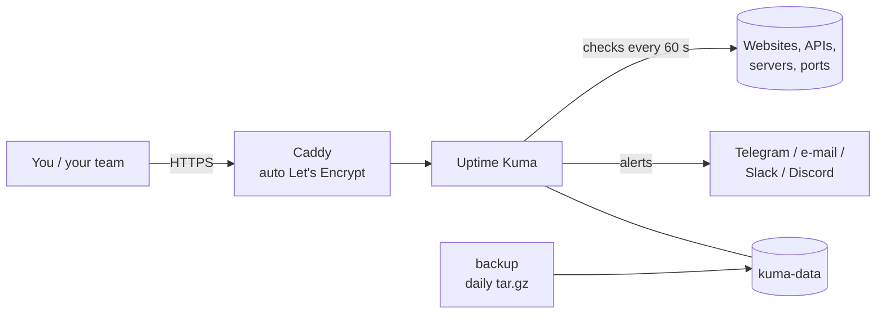

# selfhosted-monitoring-stack

[](https://github.com/andriarezki/selfhosted-monitoring-stack/actions/workflows/ci.yml)


Know your website is down **before your users tell you**. A production-ready, one-command setup of [Uptime Kuma](https://github.com/louislam/uptime-kuma) with automatic HTTPS and daily backups, for a small VPS (1 vCPU / 1 GB RAM is enough).



## What you get

- **Uptime Kuma**: HTTP(S), keyword, TCP port, ping, DNS and certificate-expiry checks; 90+ notification channels (Telegram, e-mail, Slack, Discord, WhatsApp gateways...); public status pages
- **Caddy reverse proxy**: HTTPS certificate issued and renewed automatically, HSTS and security headers, HTTP/3
- **Kuma is not exposed directly**: only Caddy publishes ports 80/443
- **Daily backups** of the Kuma database, kept for 7 days, plus a one-line restore
- Health checks and `restart: unless-stopped` on every service
- CI validates the compose file, lints the scripts and tests the backup script

## Quick start

Requirements: a VPS with Docker + Compose plugin, and a domain (e.g. `status.example.com`) with an A record pointing to the server. Ports 80 and 443 must be free.

```bash
git clone https://github.com/andriarezki/selfhosted-monitoring-stack.git
cd selfhosted-monitoring-stack
cp .env.example .env
nano .env                 # set DOMAIN and ACME_EMAIL
docker compose up -d
```

Open `https://status.example.com`, create the admin account, then add your monitors and a Telegram notification (*Settings → Notifications*).

> New server? Secure it first with [vps-hardening](https://github.com/andriarezki/vps-hardening) (`ALLOW_PORTS="80 443"`).

## Backups

The `backup` service writes `backups/kuma-YYYY-MM-DD_HHMM.tar.gz` every day at `BACKUP_HOUR` and deletes copies older than `BACKUP_KEEP_DAYS`.

```bash
docker compose exec backup sh /backup.sh                       # back up now
./scripts/restore.sh backups/kuma-2026-10-12_0200.tar.gz       # restore
```

Copy `backups/` off the server too (rclone, rsync, NAS). A backup on the same disk is not a backup.

## Configuration (`.env`)

| Variable | Default | Description |
|---|---|---|
| `DOMAIN` | (required) | public hostname for the dashboard |
| `ACME_EMAIL` | | e-mail for Let's Encrypt notices |
| `TZ` | `UTC` | time zone for Kuma |
| `BACKUP_HOUR` | `2` | hour of the daily backup (container time) |
| `BACKUP_KEEP_DAYS` | `7` | how many days of backups to keep |

## Updating

```bash
docker compose pull && docker compose up -d
```

## Suggested monitors

| Type | Example | Why |
|---|---|---|
| HTTP(S) keyword | homepage contains your brand name | catches "200 OK but broken page" |
| Certificate expiry | your domain | warns 14 days before SSL expires |
| TCP port | database / SSH | server reachable even if the web app is down |
| Ping | office router or VPN endpoint | network-level outages |
| Push | a cron job calls the push URL | alerts when a scheduled job stops running |

## License

MIT © Andria Rezki · [andriarezki.tech](https://andriarezki.tech)
